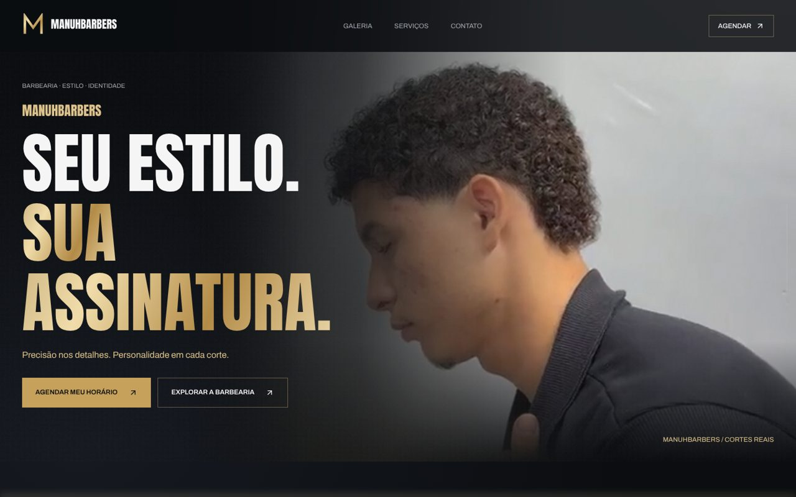
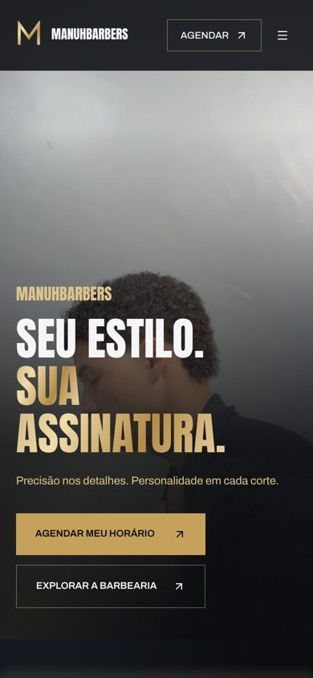

# 💈 Manuhbarbers: Sistema de Agendamento + Painel Administrativo

Sistema completo para barbearia, em produção. O cliente agenda o horário online, e o dono gerencia a operação inteira por um painel administrativo.

**🔗 Ao vivo:** [emanuelbarbers.netlify.app](https://emanuelbarbers.netlify.app/)

  
  

## O problema

A agenda era controlada por mensagens no WhatsApp. Isso gerava horário perdido, cliente esquecido e nenhuma visão do faturamento.

## A solução

**Área do cliente**
- Agendamento online com escolha de serviço, profissional, data e horário
- Lista de espera, convites e página de privacidade

**Painel administrativo** (`/admin`)
- **Agenda** do dia e da semana, **clientes** e **lista de espera**
- **Equipe e colaboradores**, com **remuneração** e **ganhos** por profissional
- **Financeiro** e **relatórios**
- **Estoque** de produtos
- **Clube de assinatura**, **cupons** e campanhas de **retorno** de clientes
- Configurações, perfil e central de ajuda

**Segurança:** autenticação e dados no Supabase, com regras de acesso (RLS) no próprio banco. O front-end usa apenas a chave pública `anon`.

## Stack

`React` · `TypeScript` · `TanStack Router/Query` · `Tailwind CSS` · `Supabase (Postgres + Auth)` · `Netlify`

> Este repositório contém o build de produção publicado no Netlify.

---

Desenvolvido por **Gustavo Pires**: sites, sistemas e automações para negócios reais.
